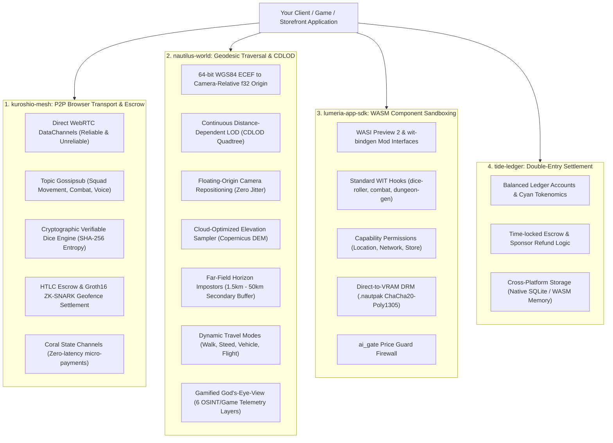

# Kuroshio SDK: Open Feature Matrix & Graphical Tooling Guide

This specification defines the complete feature set that applications must consume from the **Kuroshio SDK**, as well as the authoritative **Graphical Tooling Architecture** (Bevy, wgpu, WebGPU/WebGL2, WGSL Compute Shaders, and 3D Gaussian Splatting) for building on the Nautilus planetary world engine.

---

## Part 1: Complete SDK Feature Matrix for Applications

Every community app, mod, guild outpost, vehicle simulator, or game client building on `kuroshio-sdk` must leverage the following four pillars:

### 1. Peer-to-Peer Browser Mesh & Squad Synchronization (`kuroshio-mesh`)
- **Dual WebRTC DataChannels**:
  - `ReliableOrdered`: Authoritative transactional turns, combat actions, quest state transitions, and item trades.
  - `UnreliableLossTolerant`: 60Hz tick telemetry for kinematic character controllers, vehicle velocities, and head/camera tracking.
- **Topic-Based Gossipsub Protocol**: Distributed multicast topics (`SquadMovement`, `CombatEvents`, `CoralSettlement`, `SirenVoiceStream`, `DungeonState`) operating in-browser (`wasm32-unknown-unknown`) without central relay bottlenecks.
- **Verifiable Squad Dice Roller (`verifiable_dice_roll`)**: D&D dice types ($d4, d6, d8, d10, d12, d20, d100$) derived from deterministic SHA-256 entropy seeds (`session_seed + nonce + roller_pubkey + timestamp`), ensuring verifiable cryptographic fairness across all peers.
- **Off-Ledger Coral State Channels**: Bilateral micro-transactions (0.1 CYAN station tipping, toll-gate crossing, consumable purchases) running with sub-millisecond execution.

### 2. Trustless HTLC Escrow & Zero-Knowledge Geofencing (`kuroshio-mesh`)
- **Hash-Time-Locked Contracts (HTLCs)**: Conditional payouts unlocked by secret SHA-256 preimages or automatically refunded to sponsors on expiration.
- **Groth16 ZK-SNARK Geofence Verification (`claim_escrow_with_zk_proof`)**: Trustless settlement that cryptographically verifies arrival within target WGS84 zones without leaking player GPS fixes to the public network.
- **`LocationDisclosurePolicy` Privacy Boundaries**: Enforces strict vaulting of private device coordinates on Club Home Nodes, exposing only coarse geohashes or zero-knowledge proximity proofs.

### 3. Continuous Geodetic Traversal & Planetary Terrain Engine (`nautilus-world`)
- **Continuous Distance-Dependent Level of Detail (CDLOD)**: Sliding $3\times 3$ or $5\times 5$ quadtree chunks dynamically adjusting terrain vertex density and geomorph factors ($k \in [0.0, 1.0]$) to eliminate geometry popping.
- **Cloud-Optimized DEM Sampler (`CloudOptimizedDemSampler`)**: Hierarchical raster sampling of global elevation datasets (Copernicus DEM GLO-30 / SRTM) for continuous, infinite terrain.
- **Floating-Origin Camera Repositioning (`FloatingOriginCamera`)**: Maps 64-bit planetary ECEF math down to 32-bit camera-relative shader offsets, rebasing the local origin whenever translation exceeds 500m to eliminate 32-bit GPU floating-point vertex jitter.
- **Far-Field Horizon Impostors (`FarFieldHorizonManager`)**: Renders distant cities, mountain ranges, and orbital beacons in a secondary depth buffer ($1.5\text{ km} - 50\text{ km}$), smoothly cross-fading ($750\text{ m} - 1500\text{ m}$) into tactical CDLOD meshes.
- **Dynamic Geodetic Travel Modes (`TravelMode`)**:
  - `Walking` ($1.4\text{ m/s}$ / $5\text{ km/h}$)
  - `MountedSteed` ($9.5\text{ m/s}$ / $34\text{ km/h}$)
  - `TacticalVehicle` ($27.8\text{ m/s}$ / $100\text{ km/h}$)
  - `AtmosphericFlight` ($150.0\text{ m/s}$ / $540\text{ km/h}$)
- **Unified God's-Eye-View Single Globe Telemetry (`GodsEyeGlobalState`)**:
  - `AviationAdsB` (ADS-B/OpenSky live flights with Cockpit Ride-Along)
  - `MaritimeAis` (Vessel AIS tracking and Kuroshio mesh carriers)
  - `OrbitalSatellites` (NORAD TLE orbital propagation)
  - `SeismicWildfireWeather` (Earthquake and thermal hotspot feeds)
  - `SdrSirenRadio` (Seven Daughters 432Hz spatial broadcast nodes)
  - `VrGuildMarketplace` (Storefronts, 3D splat bazaars, and escrow bounties)

### 4. WebAssembly Component Model & Sandboxed Modding (`lumeria-app-sdk`)
- **Official WIT Standard (`wit/lumeria-mod.wit`)**: Standardized WebAssembly Component Model bindings using `wit-bindgen` and WASI Preview 2 for cross-language mod development (Rust, TinyGo, Zig, C++).
- **Extensible Hook Interfaces**:
  - `dice-roller`: Mod-level ability checks and skill rolls.
  - `combat-events`: Custom damage mitigation, elemental buffs, and Seraphic memory seal triggers.
  - `procedural-dungeon`: Procedural room and corridor generation passes.
- **Security & Asset Protection**:
  - Granular capability-based permission manifests.
  - ChaCha20-Poly1305 encrypted `.nautpak` containers decrypted directly into GPU VRAM.
  - `ai_gate` Price Guard firewall blocking prompt-injection attacks on shopping cart payloads.

---

## Part 2: Recommended Graphical Tooling Architecture

When developers ask: *"What graphical tools should we be using? Should we use Bevy?"*

Here is the authoritative graphical engineering stack recommended for all Nautilus and Kuroshio SDK applications:

### 1. The Core ECS & App Architecture: `bevy_ecs` (Modular Headless ECS)
- **Recommendation**: **Use `bevy_ecs` as a standalone, modular crate**, rather than pulling in the monolithic `bevy` engine crate for WebAssembly targets.
- **Why?**
  - **Binary Size & Startup Latency**: Full `bevy` with default plugins generates 30MB–80MB `.wasm` binaries with high cold-start times. By using `bevy_ecs`, `bevy_reflect`, and `bevy_tasks` modularly, your release WebAssembly binary remains **under 1MB** (e.g. `lemuria_leptos_client.wasm` is ~855 KB).
  - **Deterministic Accumulator Compatibility**: `bevy_ecs` provides world-class archetype-based entity storage, parallel query scheduling, and change detection, while allowing you to drive simulation ticks strictly through a deterministic 60Hz physics stepper (`DeterministicPhysicsStepper`).

### 2. The Universal Low-Level Rendering Backend: `wgpu` & WGSL
- **Recommendation**: Standardize on **`wgpu`** (`WebGPU` natively in browser, or targeting Vulkan / Metal / DirectX 12 on native desktop).
- **Shading Language**: Write custom compute and raster pipelines in **WGSL** (WebGPU Shading Language).
- **Core Rendering Passes**:
  1. **Clustered Forward+ Grid**: Evaluates $16 \times 9 \times 24 = 3,456$ froxels in a WGSL compute pass to support hundreds of dynamic point/spot lights with constant-time lookup.
  2. **Hierarchical Z-Buffer (HZB) Occlusion Culling**: GPU-driven compute pass reading camera depth mip-pyramids to generate indirect draw buffers (`DrawIndexedIndirectCommand`), completely bypassing CPU draw-call bottlenecks.
  3. **Continuous CDLOD Terrain Shader**: Computes vertex elevation displacements from Cloud-Optimized DEM textures and smoothly morphs chunk borders via continuous geomorph factors.

### 3. High-Fidelity Photorealistic Visuals: 3D Gaussian Splatting
- **Recommendation**: Use **3D Gaussian Splatting** (`.ply` / `.splat` formats compiled to `.nautpak`) for storefront totems, architectural landmarks, natural rock formations, and avatar equipment.
- **Sorting Pipeline**: Implement an 8-bit, 4-pass LSD radix sort in a compute shader to sort millions of splats along camera view depth at 60 FPS.
- **Collision Synthesis**: Storefronts and totems must ingest point clouds through `lemuria_baker::GaussianSplatIngestor` to automatically generate convex hull Rapier3D collider proxies (`SplatConvexHullCollider`).

### 4. 2D / HUD & Pause Matrix Tooling: `egui` or Leptos / HTML5 Viewports
- **Native Desktop**: Use **`egui`** atop `wgpu`. Zero Chromium, zero Electron, zero Dart overhead. Compiles directly into native machine code.
- **Web / Mobile Browser**: Render the 3D scene into `<canvas id="nautilus-viewport">` via `wgpu` (WebGL2/WebGPU backend), and render tactical HUD overlays (such as the HeavenlyBound Lite 6-tab matrix) using Leptos or responsive DOM panels.

### 5. Kinematic Animation & Physics Tooling
- **Physics**: **Rapier3D** (`rapier3d` / `parry3d`) for continuous collision detection (CCD) and capsule sweeps.
- **Vehicle Dynamics**: Raycast suspension with the **Pacejka '96 Magic Formula** for realistic tire slip angles and drifting on terrain.
- **Skeletal Animation**: **Dual-Quaternion Linear Blending (DLB)** (`kimodo_pipeline`). Avoids classical matrix candy-wrapper skinning defects while keeping memory footprints cache-aligned within a 16MB zero-allocation frame ring buffer.

---

### Graphical Tool Comparison Matrix

| Technology | Role in Nautilus Stack | Status / Guidance | Why? |
| :--- | :--- | :--- | :--- |
| **`bevy_ecs`** | Archetype ECS & Systems | **Recommended (Core)** | High-speed cache-friendly data structures; modular crate fits in <1MB Wasm. |
| **Full `bevy` Monolith** | Engine Framework | *Optional / Desktop Only* | Default plugins inflate WASM binary sizes and introduce web event-loop quirks. |
| **`wgpu`** | Graphics & Compute API | **Mandatory Standard** | Cross-platform Rust standard targeting WebGPU / WebGL2 / Vulkan / Metal natively. |
| **WGSL** | Shaders & Compute Passes | **Mandatory Standard** | Clustered Forward+ froxels, HZB occlusion culling, and CDLOD vertex geomorphing. |
| **3D Gaussian Splatting** | Photorealistic Props & Totems | **Recommended** | High-fidelity real-world captures with auto-synthesized Rapier3D convex hulls. |
| **Rapier3D** | Continuous 3D Physics | **Mandatory Standard** | Deterministic 60Hz step accumulator with character capsule stair-stepping. |
| **`egui`** | Native Desktop HUD & Menus | **Recommended** | Zero-Electron / Zero-Chromium immediate mode GUI directly on top of `wgpu`. |
